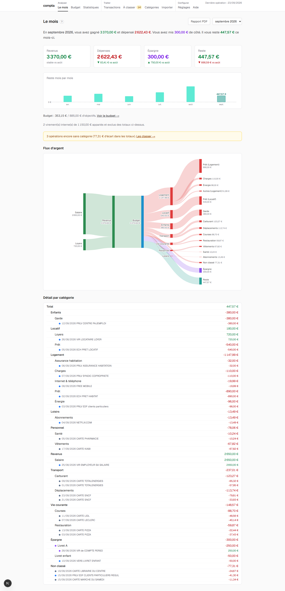
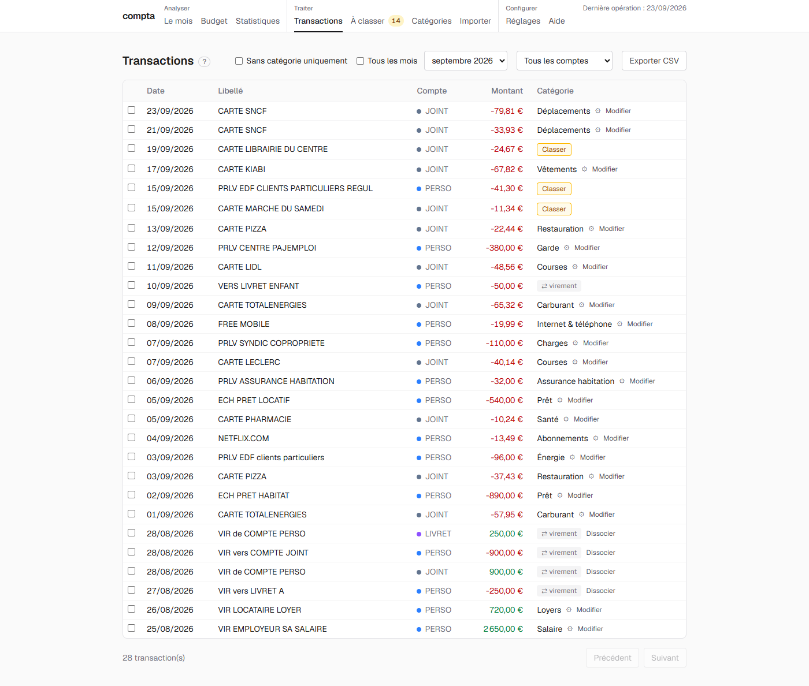
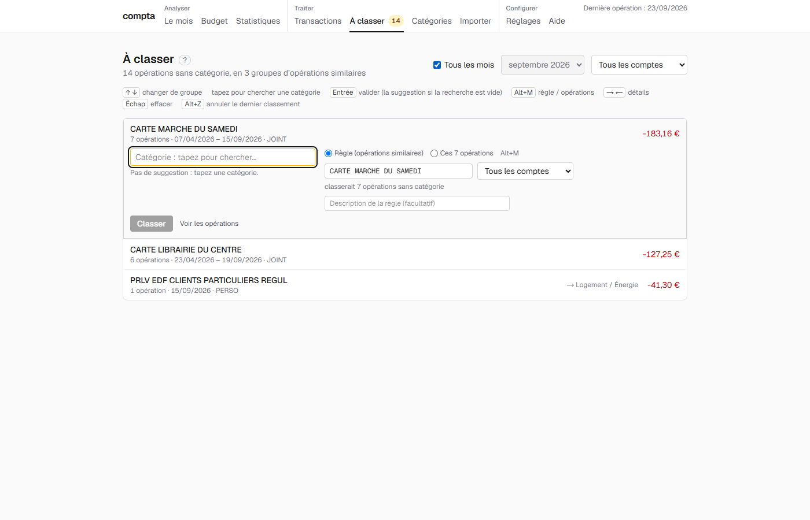
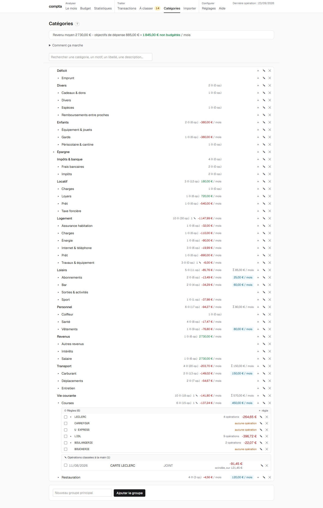
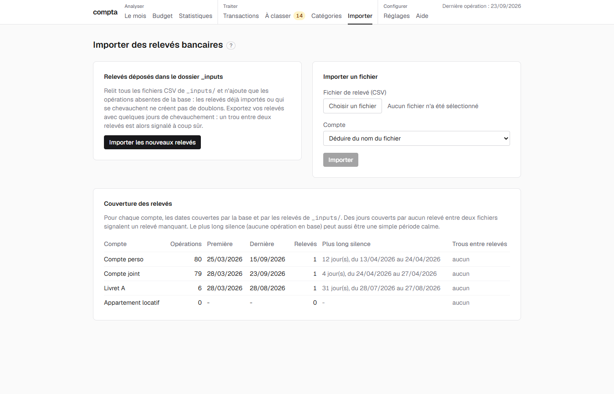
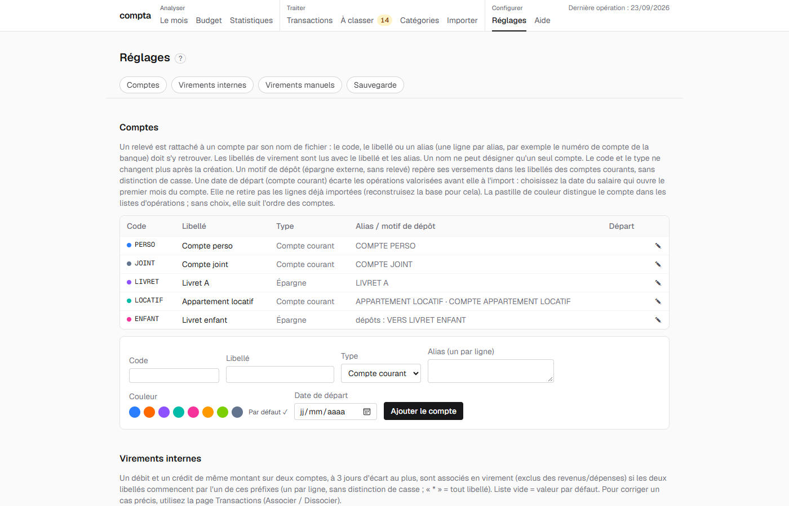

# Guide de compta

Ce guide explique chaque page de l'application et les gestes courants. L'installation et les fichiers de `_config/` sont décrits dans le README à la racine du dépôt (en anglais). Chaque page a un lien « ? » à côté de son titre qui renvoie ici.

## Bien démarrer

compta suit des **flux** (ce qui entre et ce qui sort), jamais des **soldes** : l'application ne sait pas combien il reste sur un compte, et ce n'est pas son but.

Les notions à connaître :

- **Compte** : un compte courant, un livret importé (relevé CSV), ou un compte d'épargne externe sans relevé (par exemple le livret d'un enfant), dont les versements sont repérés dans les libellés d'un compte courant. Chaque compte a une couleur (une pastille devant son code dans les listes d'opérations) pour les distinguer d'un coup d'œil.
- **Mois budgétaire** : il suit le salaire, pas le calendrier. Un crédit reconnu comme « salaire » (règle marquée « ancre de revenu ») ouvre un mois ; toutes les opérations jusqu'au salaire suivant lui appartiennent. Un salaire versé à partir du 15 paie le mois suivant.
- **Nature d'une opération** : revenu, dépense ou virement. Un virement interne (une sortie d'un compte et une entrée du même montant sur un autre compte, à moins de 3 jours) n'est ni un revenu ni une dépense.
- **Catégorie** : un arbre unique. On classe une opération dans une **feuille** (une catégorie sans sous-catégorie), jamais dans un groupe.
- **Règle** : un morceau de libellé (texte simple, majuscules et minuscules comptent) qui classe automatiquement les opérations qui le contiennent. Une règle peut être limitée à un compte (voir « Catégories »). Un classement fait à la main sur une opération n'est jamais écrasé par une règle.

Le cycle habituel : on dépose les relevés dans « Importer », on classe ce qui reste dans « À classer », puis on lit le « Tableau de bord ».

## Tableau de bord

En haut, le mois affiché (liste déroulante, « Tous les mois » pour l'ensemble de la période, « Dernier mois » pour revenir au plus récent) et le lien « Rapport PDF ».

- **Les quatre cartes** : Revenus, Dépenses, Épargne et Reste. Elles se réconcilient : Revenus - Dépenses - Épargne = Reste. Les variations par rapport au mois précédent sont indiquées (masquées dans « Tous les mois »).
- **Reste mois par mois** : une barre par mois. Le mois affiché est en couleur pleine, le mois en cours (encore incomplet) est en pointillés. Un clic sur une barre bascule sur ce mois. Un mois « partiel » (voir ci-dessous) est signalé dans l'infobulle et dans la liste déroulante des mois.
- **Budget** : pour chaque catégorie qui a un objectif, la dépense du mois face à son plafond. Vert sous 90 %, orange entre 90 et 100 %, rouge au-delà. Le solde du budget (revenu de référence - objectifs de dépense - objectif d'épargne) passe au rouge s'il est négatif : c'est un avertissement, jamais un blocage.
- **Flux d'argent** : un diagramme de Sankey qui part des revenus, passe par le budget et finit dans les groupes de dépenses, l'épargne et le Reste (ou le Découvert quand les sorties dépassent les entrées).
- **Arbre des catégories** : le total par catégorie. Cliquer sur une feuille affiche ses opérations, chacune précédée de la pastille de couleur de son compte ; les lignes d'épargne d'un compte importé portent aussi la leur.
- **Avertissement « non classé »** : des opérations sans catégorie faussent les totaux par catégorie. Elles se traitent dans « À classer ».

### Épargne et désépargne

Pour chaque compte d'épargne, l'application calcule le net du mois : positif, c'est de l'**épargne** (comptée dans la carte Épargne) ; négatif, c'est de la **désépargne** (un retrait, compté en déficit). Sur « Tous les mois », un même compte peut donc apparaître des deux côtés, sans que l'un annule l'autre.

### Rapport PDF

Le lien « Rapport PDF » ouvre une version imprimable pour le foyer. Choisir le mois (par défaut le dernier mois complet), puis « Enregistrer en PDF » : dans la fenêtre d'impression du navigateur, choisir « Enregistrer au format PDF » et décocher les en-têtes et pieds de page.

Le rapport montre une synthèse (cartes, tendance, « Comment lire »), les derniers mois, le détail du mois, le détail par catégorie (avec les opérations de chaque feuille) et le diagramme des flux. Ses Revenus et Dépenses sont **nets des remboursements** : ils peuvent être plus bas que ceux du tableau de bord, mais le Reste est identique. Un montant notable est en gras rouge ou vert : au-dessus de son objectif, ou à la fois d'au moins 20 euros et 20 % d'écart avec sa moyenne.

## Statistiques

La page « Statistiques » regroupe les moyennes mensuelles. En haut à droite, la liste déroulante choisit le mois comparé à la moyenne (« Tous les mois » masque les écarts).

**Moyennes mensuelles** : le mois moyen de chaque catégorie sur les 3, 6, 12 derniers mois complets ou « tout ». Le mois en cours est toujours exclu, car il se remplit encore, de même que les mois « partiels » : un mois est partiel tant qu'un compte courant importé n'avait pas démarré (sa date de départ, sinon sa première opération, tombe plus de 4 jours après l'ouverture du mois par le salaire). Ses totaux manquent des flux de ce compte, ils ne sont pas comparables ; ils restent comptés dans « Tous les mois ». La fenêtre peut donc compter moins de mois que demandé, et elle grandit à chaque nouveau mois complet. La colonne « Moyenne / mois » est signée (revenus moins dépenses), « Écart » compare le mois affiché à la moyenne, « Objectif » rappelle le plafond. Seule la cellule « Objectif » d'une catégorie qui a son propre objectif prend une couleur. Le bloc « Comptes d'épargne » donne, par compte, ce qui a été mis de côté par mois.

## Transactions

La liste des opérations, avec des filtres (mois, compte, catégorie, texte, « Sans catégorie uniquement »…). La date affichée est la **date de valeur**. Le compte de chaque ligne est affiché par son code (et non plus par le nom brut du relevé), précédé de la pastille de sa couleur ; le libellé du compte s'affiche au survol.

- **Classer une opération** : ouvrir l'éditeur de la ligne, choisir une catégorie (feuille), puis soit « Cette opération » (classement manuel, avec une description facultative), soit « Règle (opérations similaires) » (crée une règle, éventuellement limitée à un compte, avec le nombre d'opérations qu'elle classerait).
- **Scinder une opération** : dans l'éditeur de la ligne (« Cette opération »), « Scinder » répartit l'opération entre deux catégories : indiquer le montant de la deuxième part et sa catégorie, la première part garde le reste (un ticket de caisse qui mêle courses et maison, par exemple). La ligne affiche alors « Courses + Maison ». Filtrée par catégorie, la liste montre la part de cette catégorie. « Annuler le split » puis « Valider » remet toute l'opération dans la première catégorie. Un virement ne se scinde pas, et changer la catégorie d'une opération scindée, la classer en masse ou la déplacer depuis la page Catégories supprime le split. L'export CSV compte une ligne par part.
- **Badges** : ⚙ indique un classement par règle, ✎ un classement manuel.
- **Associer deux opérations en virement** : cocher deux lignes (une sortie, une entrée de même montant sur deux comptes), puis « Associer en virement ». Cocher une seule ligne offre « Marquer comme virement » (virement à un seul côté). Sur une ligne déjà virement, « Dissocier » la détache et « Auto » rend la décision à la détection automatique.
- **Exporter CSV** : toutes les opérations du filtre en cours, au format d'un Excel français.

## À classer

Les opérations sans catégorie, regroupées par libellé semblable. Pour chaque groupe, on choisit une catégorie : un groupe de plusieurs opérations propose par défaut une **règle**, une opération isolée un **classement manuel**. Une règle créée ici vaut pour tous les comptes ; le champ compte, à côté du motif, la limite à un compte.

- Au clavier : ↑/↓ changent de groupe, Entrée classe dans la catégorie proposée, Alt+M bascule règle / manuel, →/← montrent ou cachent les opérations, Échap efface la saisie.
- « Annuler » (8 secondes, ou Alt+Z) défait le dernier classement.
- **Conflit de règles** : en tête de page, les opérations qui correspondent à des règles de catégories différentes. Elles restent sans catégorie (l'application ne choisit pas). Chacune liste les règles en cause, avec un lien vers la recherche de la règle dans « Catégories » pour la corriger, et un sélecteur pour la classer à la main. Lors de la création d'une règle, l'aperçu annonce « N opérations correspondent aussi à la règle X (catégorie Y) » quand elle créerait un conflit.
- « Virement interne ? » propose d'associer l'opération à son pendant sur un autre compte.
- Le compteur à côté de l'onglet « À classer » indique combien d'opérations restent.
- Le compte des opérations listées (celles d'un groupe, les virements possibles, les conflits de règles) est précédé de la pastille de sa couleur.

## Catégories

L'arbre des catégories, avec pour chacune les règles, les opérations classées à la main et la moyenne mensuelle.

- **Créer, renommer, déplacer, supprimer** : ＋ ajoute une sous-catégorie, ✎ renomme ou change le parent, ✕ supprime. Créer une sous-catégorie sous une feuille déjà utilisée y descend ses règles et ses opérations. Supprimer la dernière sous-catégorie d'un groupe remonte ses règles et ses opérations sur le parent.
- **Fixer un objectif de budget** : « ＋ objectif » sur une feuille ou un groupe, un montant mensuel en euros. Un seul objectif par branche. Un objectif sur le groupe « Épargne » est l'objectif d'épargne mensuel (un plancher).
- **Règles** : déplier une feuille pour voir ses règles (ancre de revenu, opérations touchées), les modifier, les supprimer, ou « ＋ règle ». Une règle s'applique par défaut à « Tous les comptes » ; le champ compte la limite à un seul compte (pour deux comptes sur trois, créer deux règles). Une règle d'un compte l'emporte toujours sur une règle de tous les comptes : ce n'est pas un conflit, c'est la façon de classer le même libellé autrement selon le compte. Il n'y a pas d'autre priorité : si deux règles de catégories différentes du même niveau (deux règles de tous les comptes, ou deux règles du même compte) correspondent à la même opération, c'est un **conflit** (voir « À classer »). Une règle d'ancre de revenu limitée à un compte n'ouvre un mois que pour les crédits de ce compte. Enregistrer une règle qui crée un conflit affiche un avertissement, la règle est enregistrée quand même. Deux règles de la même catégorie ne sont jamais en conflit.
- **Déplacer des règles ou des opérations** : cocher, choisir la feuille cible. Une opération scindée apparaît sous ses deux catégories avec sa part (« scindée, sur N € ») ; la déplacer la met en entier dans la feuille cible et supprime le split. Une opération classée par règle ne se déplace pas seule : « Classer à part » la rend manuelle.
- **Recherche** : sur les noms, les motifs de règles et les libellés ou notes manuels (sans tenir compte des accents ni de la casse).

## Importer des relevés

- **Envoyer un relevé** : choisir le fichier CSV de la banque. Le compte est déduit du nom du fichier, qui doit contenir le nom du compte ou l'un de ses alias. Un fichier dont le compte est inconnu est refusé.
- **Importer les nouveaux relevés** : prend en compte les fichiers déposés dans le dossier `_inputs/`. Les opérations déjà connues sont ignorées, rien n'est supprimé.
- Les relevés envoyés sont archivés dans `_inputs/`. Les opérations antérieures à la date de départ sont écartées : celle de `settings.toml` (`start_date`, pour toute la comptabilité) ou celle du compte (voir Réglages), la plus tardive des deux.
- Au premier import d'un compte, si ses opérations commencent plus de 4 jours après l'ouverture du mois budgétaire (le versement du salaire qui l'ouvre), un avertissement orange le signale et propose la date du salaire suivant comme date de départ du compte : ce mois-là serait incomplet pour lui. L'avertissement n'empêche rien.
- La couverture par compte signale les trous entre deux relevés.

## Réglages

- **Comptes** : la liste des comptes, avec ✎ pour modifier le libellé, les alias, le motif de dépôt, la date de départ et la couleur d'un compte, et un formulaire pour en ajouter un. Le code et le type ne changent plus après la création. Un relevé est rattaché à un compte par son nom de fichier : le code, le libellé ou un alias (par exemple le numéro de compte de la banque) doit s'y retrouver. Un nom ne peut désigner qu'un seul compte. La date de départ (comptes courants) écarte à l'import les opérations valorisées avant elle ; choisissez la date du salaire qui ouvre le premier mois du compte. Modifier cette date ne retire pas les lignes déjà importées : reconstruisez la base (`reset_db.py`). La couleur se choisit parmi huit pastilles ; sans choix (« Par défaut »), le compte prend une couleur selon sa position dans la liste, donc deux comptes peuvent partager la même. Enregistrer un compte recalcule les virements, car les noms des comptes servent à les reconnaître.
- **Virements internes** : les débuts de libellé qui signalent un virement (par défaut `VIR`). `*` accepte n'importe quel libellé.
- **Virements manuels** : les opérations appariées à la main, par paires, avec « Auto » pour rendre la main à la détection.
- **Sauvegarde** : « Enregistrer la configuration » écrit les comptes, catégories, règles et décisions manuelles dans `_config/`, pour pouvoir reconstruire la base.

### Sauvegardes et reconstruction

Les opérations viennent toujours de `_inputs/`. Une copie complète de l'état = « Enregistrer la configuration » + les fichiers de `_inputs/`. La reconstruction d'une base se fait en ligne de commande (`reset_db.py`) : voir le README à la racine du dépôt.

## Aide

Cette page est le guide. Les liens « ? » à côté des titres y renvoient. Le guide se lit aussi sur GitHub, dans `docs/guide.md`.
