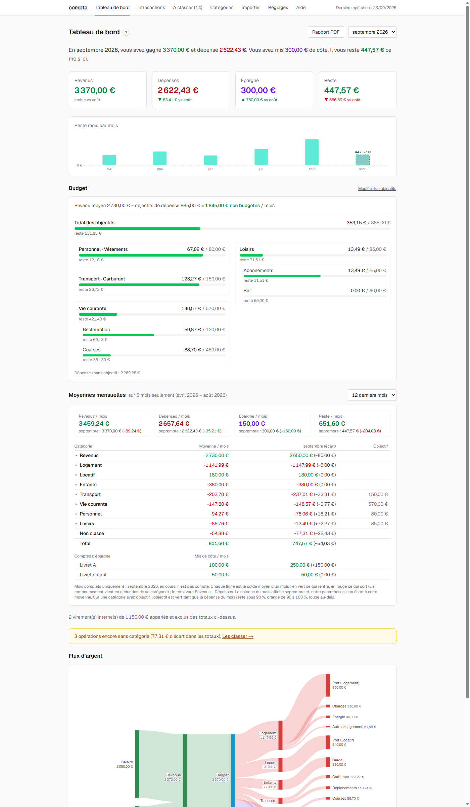
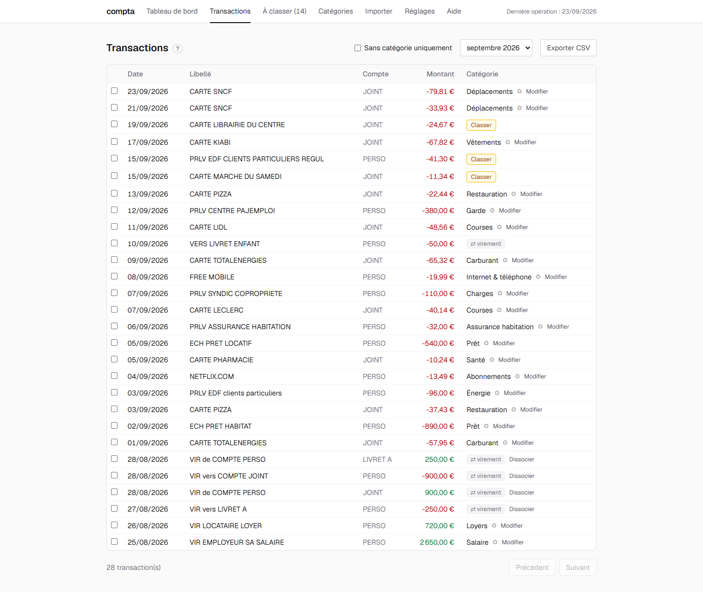
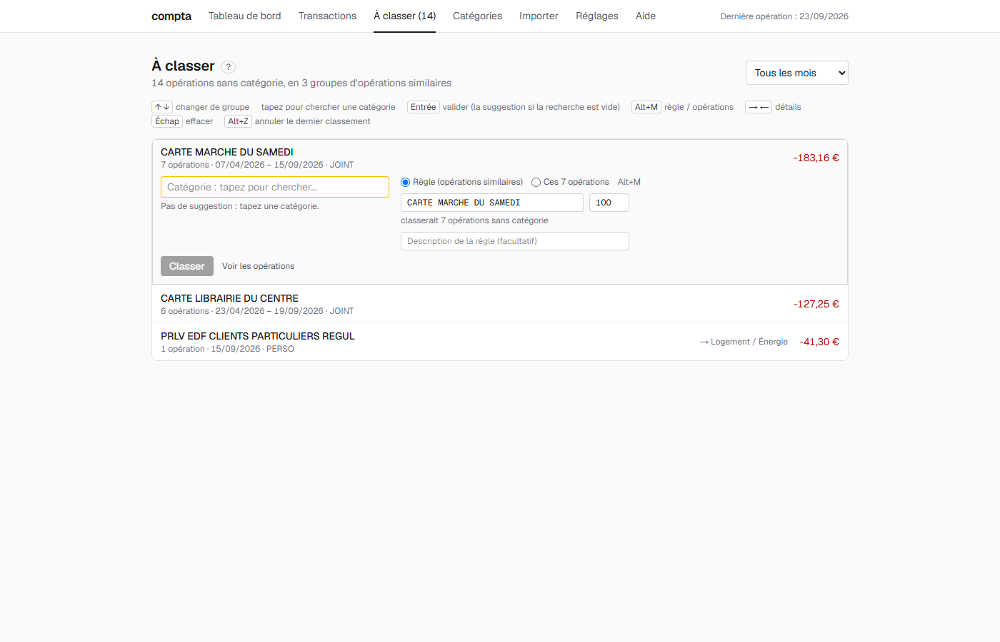
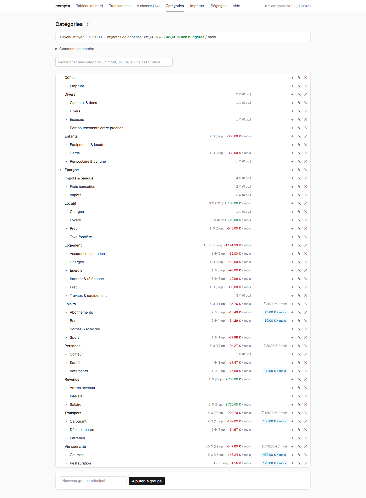
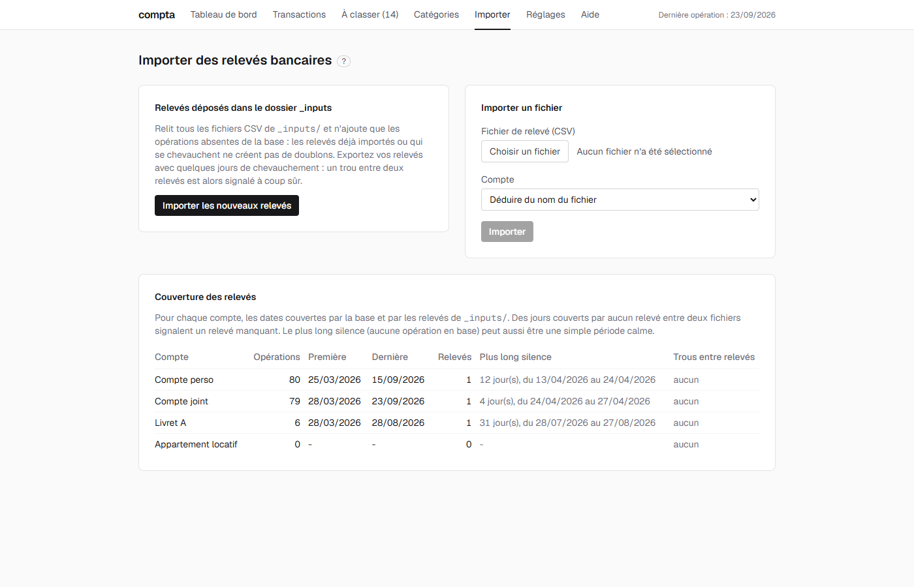
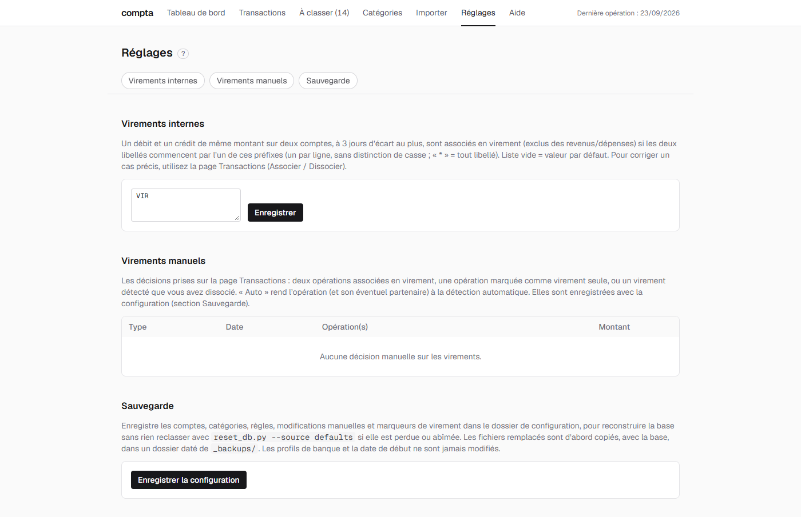

# Guide de compta

Ce guide explique chaque page de l'application et les gestes courants. L'installation et les fichiers de `_config/` sont décrits dans le [README](../README.md) (en anglais). Chaque page a un lien « ? » à côté de son titre qui renvoie ici.

## Bien démarrer

compta suit des **flux** (ce qui entre et ce qui sort), jamais des **soldes** : l'application ne sait pas combien il reste sur un compte, et ce n'est pas son but.

Les notions à connaître :

- **Compte** : un compte courant, un livret importé (relevé CSV), ou un compte d'épargne externe sans relevé (par exemple le livret d'un enfant), dont les versements sont repérés dans les libellés d'un compte courant.
- **Mois budgétaire** : il suit le salaire, pas le calendrier. Un crédit reconnu comme « salaire » (règle marquée « ancre de revenu ») ouvre un mois ; toutes les opérations jusqu'au salaire suivant lui appartiennent. Un salaire versé à partir du 15 paie le mois suivant.
- **Nature d'une opération** : revenu, dépense ou virement. Un virement interne (une sortie d'un compte et une entrée du même montant sur un autre compte, à moins de 3 jours) n'est ni un revenu ni une dépense.
- **Catégorie** : un arbre unique. On classe une opération dans une **feuille** (une catégorie sans sous-catégorie), jamais dans un groupe.
- **Règle** : un morceau de libellé (texte simple, majuscules et minuscules comptent) qui classe automatiquement les opérations qui le contiennent. Un classement fait à la main sur une opération n'est jamais écrasé par une règle.

Le cycle habituel : on dépose les relevés dans « Importer », on classe ce qui reste dans « À classer », puis on lit le « Tableau de bord ».

## Tableau de bord

En haut, le mois affiché (liste déroulante, « Tous les mois » pour l'ensemble de la période, « Dernier mois » pour revenir au plus récent) et le lien « Rapport PDF ».

- **Les quatre cartes** : Revenus, Dépenses, Épargne et Reste. Elles se réconcilient : Revenus - Dépenses - Épargne = Reste. Les variations par rapport au mois précédent sont indiquées (masquées dans « Tous les mois »).
- **Reste mois par mois** : une barre par mois. Le mois affiché est en couleur pleine, le mois en cours (encore incomplet) est en pointillés. Un clic sur une barre bascule sur ce mois.
- **Budget** : pour chaque catégorie qui a un objectif, la dépense du mois face à son plafond. Vert sous 90 %, orange entre 90 et 100 %, rouge au-delà. Le solde du budget (revenu de référence - objectifs de dépense - objectif d'épargne) passe au rouge s'il est négatif : c'est un avertissement, jamais un blocage.
- **Moyennes mensuelles** : le mois moyen de chaque catégorie sur les 3, 6, 12 derniers mois complets ou « tout ». Le mois en cours est toujours exclu, car il se remplit encore. La colonne « Moyenne / mois » est signée (revenus moins dépenses), « Écart » compare le mois affiché à la moyenne, « Objectif » rappelle le plafond. Seule la cellule « Objectif » d'une catégorie qui a son propre objectif prend une couleur. Le bloc « Comptes d'épargne » donne, par compte, ce qui a été mis de côté par mois.
- **Flux d'argent** : un diagramme de Sankey qui part des revenus, passe par le budget et finit dans les groupes de dépenses, l'épargne et le Reste (ou le Découvert quand les sorties dépassent les entrées).
- **Arbre des catégories** : le total par catégorie. Cliquer sur une feuille affiche ses opérations.
- **Avertissement « non classé »** : des opérations sans catégorie faussent les totaux par catégorie. Elles se traitent dans « À classer ».

### Épargne et désépargne

Pour chaque compte d'épargne, l'application calcule le net du mois : positif, c'est de l'**épargne** (comptée dans la carte Épargne) ; négatif, c'est de la **désépargne** (un retrait, compté en déficit). Sur « Tous les mois », un même compte peut donc apparaître des deux côtés, sans que l'un annule l'autre.

### Rapport PDF

Le lien « Rapport PDF » ouvre une version imprimable pour le foyer. Choisir le mois (par défaut le dernier mois complet), puis « Enregistrer en PDF » : dans la fenêtre d'impression du navigateur, choisir « Enregistrer au format PDF » et décocher les en-têtes et pieds de page.

Le rapport montre une synthèse (cartes, tendance, « Comment lire »), les derniers mois, le détail du mois, le détail par catégorie (avec les opérations de chaque feuille) et le diagramme des flux. Ses Revenus et Dépenses sont **nets des remboursements** : ils peuvent être plus bas que ceux du tableau de bord, mais le Reste est identique. Un montant notable est en gras rouge ou vert : au-dessus de son objectif, ou à la fois d'au moins 20 euros et 20 % d'écart avec sa moyenne.

## Transactions

La liste des opérations, avec des filtres (mois, compte, catégorie, texte, « Sans catégorie uniquement »…). La date affichée est la **date de valeur**.

- **Classer une opération** : ouvrir l'éditeur de la ligne, choisir une catégorie (feuille), puis soit « Cette opération » (classement manuel, avec une description facultative), soit « Règle (opérations similaires) » (crée une règle, avec le nombre d'opérations qu'elle classerait).
- **Badges** : ⚙ indique un classement par règle, ✎ un classement manuel.
- **Associer deux opérations en virement** : cocher deux lignes (une sortie, une entrée de même montant sur deux comptes), puis « Associer en virement ». Cocher une seule ligne offre « Marquer comme virement » (virement à un seul côté). Sur une ligne déjà virement, « Dissocier » la détache et « Auto » rend la décision à la détection automatique.
- **Exporter CSV** : toutes les opérations du filtre en cours, au format d'un Excel français.

## À classer

Les opérations sans catégorie, regroupées par libellé semblable. Pour chaque groupe, on choisit une catégorie : un groupe de plusieurs opérations propose par défaut une **règle**, une opération isolée un **classement manuel**.

- Au clavier : ↑/↓ changent de groupe, Entrée classe dans la catégorie proposée, Alt+M bascule règle / manuel, →/← montrent ou cachent les opérations, Échap efface la saisie.
- « Annuler » (8 secondes, ou Alt+Z) défait le dernier classement.
- « Virement interne ? » propose d'associer l'opération à son pendant sur un autre compte.
- Le compteur à côté de l'onglet « À classer » indique combien d'opérations restent.

## Catégories

L'arbre des catégories, avec pour chacune les règles, les opérations classées à la main et la moyenne mensuelle.

- **Créer, renommer, déplacer, supprimer** : ＋ ajoute une sous-catégorie, ✎ renomme ou change le parent, ✕ supprime. Créer une sous-catégorie sous une feuille déjà utilisée y descend ses règles et ses opérations. Supprimer la dernière sous-catégorie d'un groupe remonte ses règles et ses opérations sur le parent.
- **Fixer un objectif de budget** : « ＋ objectif » sur une feuille ou un groupe, un montant mensuel en euros. Un seul objectif par branche. Un objectif sur le groupe « Épargne » est l'objectif d'épargne mensuel (un plancher).
- **Règles** : déplier une feuille pour voir ses règles (priorité, ancre de revenu, opérations touchées), les modifier, les supprimer, ou « ＋ règle ». Priorité plus basse = passe d'abord.
- **Déplacer des règles ou des opérations** : cocher, choisir la feuille cible. Une opération classée par règle ne se déplace pas seule : « Classer à part » la rend manuelle.
- **Recherche** : sur les noms, les motifs de règles et les libellés ou notes manuels (sans tenir compte des accents ni de la casse).

## Importer des relevés

- **Envoyer un relevé** : choisir le fichier CSV de la banque. Le compte est déduit du nom du fichier, qui doit contenir le nom du compte ou l'un de ses alias. Un fichier dont le compte est inconnu est refusé.
- **Importer les nouveaux relevés** : prend en compte les fichiers déposés dans le dossier `_inputs/`. Les opérations déjà connues sont ignorées, rien n'est supprimé.
- Les relevés envoyés sont archivés dans `_inputs/`. Les opérations antérieures à la date de départ (`start_date` dans `settings.toml`) sont écartées.
- La couverture par compte signale les trous entre deux relevés.

## Réglages

- **Virements internes** : les débuts de libellé qui signalent un virement (par défaut `VIR`). `*` accepte n'importe quel libellé.
- **Virements manuels** : les opérations appariées à la main, par paires, avec « Auto » pour rendre la main à la détection.
- **Sauvegarde** : « Enregistrer la configuration » écrit les comptes, catégories, règles et décisions manuelles dans `_config/`, pour pouvoir reconstruire la base.

### Sauvegardes et reconstruction

Les opérations viennent toujours de `_inputs/`. Une copie complète de l'état = « Enregistrer la configuration » + les fichiers de `_inputs/`. La reconstruction d'une base se fait en ligne de commande (`reset_db.py`) : voir le [README](../README.md).

## Aide

Cette page est le guide. Les liens « ? » à côté des titres y renvoient. Le guide se lit aussi sur GitHub, dans `docs/guide.md`.
